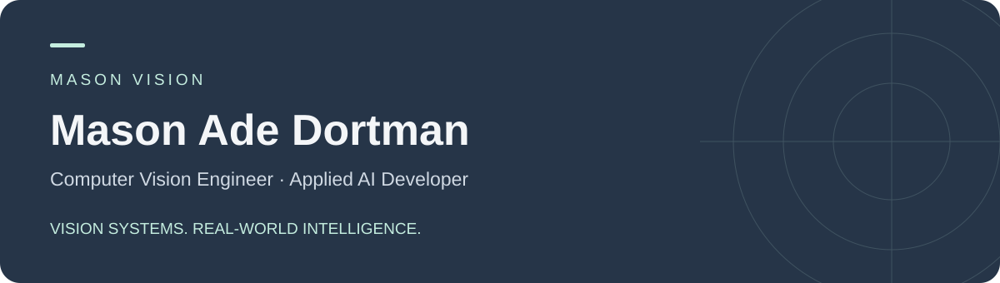

# Hi, I’m Mason Ade Dortman

**Computer Vision Engineer · Applied AI Developer · Founder & Technical Director, Mason Vision**

I focus on practical computer vision and AI solutions: turning images and video into useful information, from detection and tracking to sports analytics, action recognition and temporal event analysis.

[Explore the portfolio](https://github.com/Mason-Adedortman/mason-vision-portfolio) · [Get in touch](mailto:adedortman2020@gmail.com)

## What I focus on

- **Sports intelligence:** movement, player interactions and events in match footage.
- **Video understanding:** connecting observations across frames to actions and temporal events.
- **Detection and tracking:** identifying objects, following movement and interpreting visual scenes.
- **Applied AI:** connecting models, processing pipelines and usable outputs.

## Selected project showcases

### [Basketball AI Analysis](https://github.com/Mason-Adedortman/basketball-ai-analysis)

Detection, tracking, tactical court views and structured video-analysis outputs.

### [Tennis Analysis System](https://github.com/Mason-Adedortman/tennis-analysis-system)

Player and ball tracking, court keypoints and a mini-court video demonstration.

### [SimShieldAI](https://github.com/Mason-Adedortman/simshield-ai)

A camera-monitoring and detection-alert dashboard walkthrough.

### [PDPODS](https://github.com/Mason-Adedortman/pdpods)

License-plate records, camera context and organization management.

### [Session Replay Analytics](https://github.com/Mason-Adedortman/session-replay-analytics)

Browser interaction replay, funnels, heatmaps and session exploration.

These case studies present available project demonstrations and technical workflows. Each repository explains its scope, evidence and attribution; a showcase does not imply sole authorship or a runnable source release.

## Technical toolkit

**Python · OpenCV · PyTorch · Computer Vision · Deep Learning**

Object detection, tracking and segmentation · Image and video processing · Sports analytics · Action recognition · Temporal analysis · Model evaluation and optimization · End-to-end AI solution development

## Working approach

Understand the problem and available data → define a practical technical approach → implement and evaluate → document and deliver.

I value clear requirements, reviewable outputs, explicit project scope and evidence behind performance claims.

## Let’s build something useful

Open to computer vision projects, applied AI development and long-term technical collaborations.

**Mason Vision** · [adedortman2020@gmail.com](mailto:adedortman2020@gmail.com)
