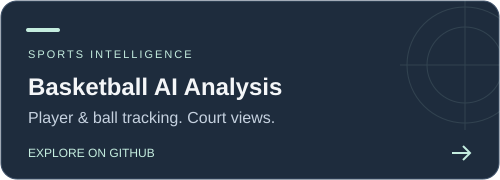
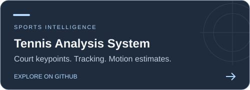
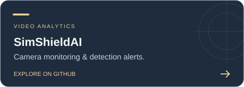
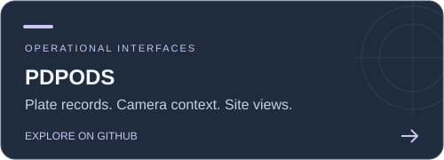
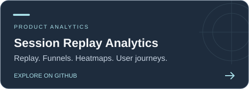
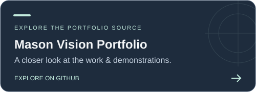

  

<h1 align="center">Hi, I’m Mason Ade Dortman 👋</h1>

<strong>Computer Vision Engineer · Applied AI Developer Founder &amp; Technical Director, Mason Vision</strong>

  
  
  

<em>Turning images and video into useful, real-world intelligence.</em>

---

## 🧠 About me

I focus on practical **computer vision and applied AI**: object detection and tracking, sports analytics, video understanding, action recognition and temporal event analysis.

Through **Mason Vision**, my focus is on connecting the technical approach with the problem it needs to solve—from understanding the footage and requirements to evaluation, documentation and delivery.

- 🎯 **Focus:** useful outputs from complex visual data.
- 🏀 **Interests:** sports intelligence, movement analysis and event detection.
- 🤝 **Open to:** computer vision projects and long-term technical collaborations.
- 📬 **Contact:** [adedortman2020@gmail.com](mailto:adedortman2020@gmail.com)

## 🛠️ Technical toolkit

  
  
  

  
  
  

**Detection · Tracking · Segmentation · Deep learning · Action recognition · Temporal analysis**

Image and video processing, model development, evaluation and optimization, and end-to-end AI solution development.

## 🚀 Selected work

Explore the problem, technical approach and available demonstration behind each project.

  
  
  
  
  
  

*Project repositories are demo-backed case studies. Their documentation identifies scope, available evidence and original credits; application source releases are not included.*

## ⚙️ How I approach a project

**Understand the problem → Design the approach → Implement & evaluate → Document & deliver**

I value clear requirements, reviewable outputs and evidence behind performance claims. A useful system should make its results understandable and its limitations clear.

---

<h3 align="center">Have a computer vision problem to solve?</h3>

Let’s talk about the footage, the challenge and what success looks like.

<strong>Mason Vision</strong> Computer vision. Applied AI. Practical outcomes.

